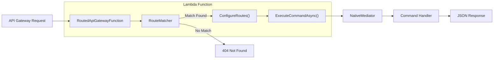

# NativeLambdaRouter

A high-performance API Gateway routing library for AWS Lambda, optimized for **Native AOT**. Provides declarative route mapping to mediator commands with path parameter extraction, health checks, and automatic error handling.

[](https://www.nuget.org/packages/NativeLambdaRouter/)
[](https://github.com/swepay/native-lambda-router/actions/workflows/dotnet.yml)

## Features

- 🚀 **Native AOT Compatible** - Full support for .NET Native AOT compilation
- 🛣️ **Declarative Routing** - Map HTTP endpoints to mediator commands with fluent API
- 📦 **Path Parameters** - Extract parameters from URLs like `/items/{id}`
- ❤️ **Health Checks** - Built-in `/health` and `/healthz` endpoints
- ⚠️ **Error Handling** - Automatic HTTP status codes for common exceptions
- 🔐 **Authorization** - Fluent authorization with policies, roles, and claims
- 🎫 **JWT Claims** - Access authenticated user claims from route context
- 🎯 **NativeMediator Integration** - Seamless integration with CQRS pattern
- 🧾 **Per-route Content-Type** - HTML/YAML or custom headers per endpoint
- 🧩 **Custom API Gateway Response** - Fallback response with custom headers

## Installation

```bash
dotnet add package NativeLambdaRouter
```

## Quick Start

### 1. Create your Lambda Function

```csharp
using System.Text.Json;
using System.Text.Json.Serialization;
using NativeLambdaRouter;
using NativeMediator;

public class Function : RoutedApiGatewayFunction
{
    public Function(IMediator mediator)
        : base(mediator)
    {
    }

    protected override void ConfigureRoutes(IRouteBuilder routes)
    {
        // GET /items - List all items
        routes.MapGet<GetItemsCommand, GetItemsResponse>(
            "/items",
            ctx => new GetItemsCommand());

        // GET /items/{id} - Get item by ID
        routes.MapGet<GetItemByIdCommand, GetItemByIdResponse>(
            "/items/{id}",
            ctx => new GetItemByIdCommand(ctx.PathParameters["id"]));

        // POST /items - Create new item
        routes.MapPost<CreateItemCommand, CreateItemResponse>(
            "/items",
            ctx => JsonSerializer.Deserialize(ctx.Body!, AppJsonContext.Default.CreateItemCommand)!);

        // PUT /items/{id} - Update item.
        // The command carries the path "id" plus whatever the body deserializes to, but the
        // actual JSON body is UpdateItemRequest, not UpdateItemCommand — Accepts<T>() tells
        // OpenAPI generators to document UpdateItemRequest as the requestBody schema instead
        // of UpdateItemCommand (which would wrongly include "id" as a required body field).
        routes.MapPut<UpdateItemCommand, UpdateItemResponse>(
            "/items/{id}",
            ctx => new UpdateItemCommand(
                ctx.PathParameters["id"],
                JsonSerializer.Deserialize(ctx.Body!, AppJsonContext.Default.UpdateItemRequest)!))
            .Accepts<UpdateItemRequest>();

        // DELETE /items/{id} - Delete item
        routes.MapDelete<DeleteItemCommand, DeleteItemResponse>(
            "/items/{id}",
            ctx => new DeleteItemCommand(ctx.PathParameters["id"]));

        // HTML / YAML example
        routes.MapGet<GetDocsCommand, GetDocsResponse>("/docs", _ => new GetDocsCommand())
            .Produces("text/html")
            .WithHeader("Cache-Control", "no-store");
    }

    protected override async Task<object> ExecuteCommandAsync(
        RouteMatch match,
        RouteContext context,
        IMediator mediator)
    {
        var command = match.Route.CommandFactory(context);

        return command switch
        {
            GetItemsCommand cmd => await mediator.Send(cmd),
            GetItemByIdCommand cmd => await mediator.Send(cmd),
            CreateItemCommand cmd => await mediator.Send(cmd),
            UpdateItemCommand cmd => await mediator.Send(cmd),
            DeleteItemCommand cmd => await mediator.Send(cmd),
            _ => throw new InvalidOperationException($"Unknown command: {command.GetType().Name}")
        };
    }

    // Required for Native AOT - serialize all response types
    protected override string SerializeResponse(object response)
    {
        return response switch
        {
            GetDocsResponse r => r.Html,
            GetItemsResponse r => JsonSerializer.Serialize(r, AppJsonContext.Default.GetItemsResponse),
            GetItemByIdResponse r => JsonSerializer.Serialize(r, AppJsonContext.Default.GetItemByIdResponse),
            CreateItemResponse r => JsonSerializer.Serialize(r, AppJsonContext.Default.CreateItemResponse),
            UpdateItemResponse r => JsonSerializer.Serialize(r, AppJsonContext.Default.UpdateItemResponse),
            DeleteItemResponse r => JsonSerializer.Serialize(r, AppJsonContext.Default.DeleteItemResponse),
            // Router internal types
            ErrorResponse r => JsonSerializer.Serialize(r, RouterJsonContext.Default.ErrorResponse),
            HealthCheckResponse r => JsonSerializer.Serialize(r, RouterJsonContext.Default.HealthCheckResponse),
            RouteNotFoundResponse r => JsonSerializer.Serialize(r, RouterJsonContext.Default.RouteNotFoundResponse),
            _ => throw new NotSupportedException($"No serializer for {response.GetType().Name}")
        };
    }
}

// Source-generated JSON context for AOT compatibility
[JsonSerializable(typeof(GetItemsCommand))]
[JsonSerializable(typeof(GetItemsResponse))]
[JsonSerializable(typeof(GetItemByIdCommand))]
[JsonSerializable(typeof(GetItemByIdResponse))]
[JsonSerializable(typeof(CreateItemCommand))]
[JsonSerializable(typeof(CreateItemResponse))]
[JsonSerializable(typeof(UpdateItemCommand))]
[JsonSerializable(typeof(UpdateItemRequest))]
[JsonSerializable(typeof(UpdateItemResponse))]
[JsonSerializable(typeof(DeleteItemCommand))]
[JsonSerializable(typeof(DeleteItemResponse))]
[JsonSourceGenerationOptions(PropertyNamingPolicy = JsonKnownNamingPolicy.CamelCase)]
public partial class AppJsonContext : JsonSerializerContext { }
```

### Custom API Gateway Response (fallback)

```csharp
protected override async Task<object> ExecuteCommandAsync(
    RouteMatch match,
    RouteContext context,
    IMediator mediator)
{
    var command = match.Route.CommandFactory(context);

    return command switch
    {
        GetDocsCommand cmd => new ApiGatewayResponse
        {
            StatusCode = 200,
            Body = "<html>...</html>",
            Headers = new Dictionary<string, string>
            {
                ["Content-Type"] = "text/html"
            }
        },
        GetItemsCommand cmd => await mediator.Send(cmd),
        CreateItemCommand cmd => await mediator.Send(cmd),
        _ => throw new InvalidOperationException($"Unknown command: {command.GetType().Name}")
    };
}
```

## Architecture



## Route Context

The `RouteContext` provides access to request information:

| Property | Type | Description |
|----------|------|-------------|
| `Body` | `string?` | Raw request body |
| `PathParameters` | `Dictionary<string, string>` | URL path parameters (`{id}` → `"123"`) |
| `QueryParameters` | `Dictionary<string, string>` | Query string parameters |
| `Headers` | `Dictionary<string, string>` | Request headers |
| `Claims` | `Dictionary<string, string>` | JWT claims (when authenticated) |

## Dependency Injection

### Singleton Mediator

Use this constructor when `IMediator` is registered as Singleton:

```csharp
public class Function : RoutedApiGatewayFunction
{
    public Function(IMediator mediator)
        : base(mediator)
    {
    }
}
```

### Scoped Mediator

Use this constructor when `IMediator` is registered as Scoped (recommended for database contexts):

```csharp
public class Function : RoutedApiGatewayFunction
{
    public Function(IServiceProvider serviceProvider)
        : base(serviceProvider)
    {
    }
}
```

The mediator is automatically resolved within a scope for each request and passed to `ExecuteCommandAsync`.

## HTTP Methods

```csharp
routes.MapGet<TCommand, TResponse>(path, commandFactory);
routes.MapPost<TCommand, TResponse>(path, commandFactory);
routes.MapPut<TCommand, TResponse>(path, commandFactory);
routes.MapDelete<TCommand, TResponse>(path, commandFactory);
routes.MapPatch<TCommand, TResponse>(path, commandFactory);

// Custom method
routes.Map<TCommand, TResponse>(method, path, commandFactory, requiresAuth: true);
```

## Request Body Type (`Accepts<TBody>()`)

Some commands are built from more than the JSON body: a path parameter, a header, a JWT
claim, and *then* a few fields from the body. The command factory needs all of that to build
`TCommand`, but the actual request payload a caller sends is narrower:

```csharp
public sealed record EnsureExternalIdpUserCommand(
    string RealmId,           // from path
    string AssertionToken,    // from header
    string CallerClientId,    // from claim
    string CallerIpAddress,   // from request context
    string ExternalIdpSource, // from body
    string? DisplayName);     // from body

routes.MapPost<EnsureExternalIdpUserCommand, EnsureExternalIdpUserResponse>(
    "/admin/v1/realms/{realmId}/external-idp-users/ensure",
    ctx =>
    {
        var body = JsonSerializer.Deserialize(
            ctx.Body!, AppJsonContext.Default.AdminEnsureExternalIdpUserRequest)!;

        return new EnsureExternalIdpUserCommand(
            RealmId: ctx.PathParameters["realmId"],
            AssertionToken: ctx.Headers["X-Assertion-Token"],
            CallerClientId: ctx.Claims["client_id"],
            CallerIpAddress: ctx.Headers["X-Forwarded-For"],
            ExternalIdpSource: body.ExternalIdpSource,
            DisplayName: body.DisplayName);
    })
    .Accepts<AdminEnsureExternalIdpUserRequest>();
```

Without `.Accepts<TBody>()`, an OpenAPI generator reading this route has no way to tell that
the body is narrower than the command, and documents `EnsureExternalIdpUserCommand`'s full
shape — including `realmId`, `assertionToken`, `callerClientId`, `callerIpAddress` — as a
*required* request body. Clients following that spec would be told to send caller-identity
fields in the JSON body that the server actually takes from the path/header/claims and never
reads from the body.

`.Accepts<TBody>()` records `RouteDefinition.RequestBodyType = typeof(TBody)` — no runtime
behavior changes, `NativeLambdaRouter` still does not touch the body itself. Doc generators
such as `NativeLambdaRouter.SourceGenerator.OpenApi` (1.9.0+) read this to emit the
`requestBody` schema for `TBody` instead of the command. Routes that never call
`.Accepts<TBody>()` are unaffected — `RequestBodyType` stays `null` and the command type is
still what gets documented, exactly as before this method existed.

See [ADR-0001](adr/0001-accepts-request-body-type.md) for why this lives on
`IRouteEndpointBuilder` rather than as a purely syntactic marker in the OpenAPI generator.

## Authorization

NativeLambdaRouter provides a fluent authorization API inspired by ASP.NET Core Minimal APIs.

### Defining Policies

Override `ConfigureAuthorization` to define named policies:

```csharp
protected override void ConfigureAuthorization(AuthorizationBuilder auth)
{
    auth.AddPolicy("admin_greetings", policy =>
        policy
            .RequireRole("admin")
            .RequireClaim("scope", "greetings_api"));
    
    auth.AddPolicy("api_access", policy =>
        policy
            .RequireClaim("scope", "api:read", "api:write")
            .RequireAssertion(ctx => ctx.Headers.ContainsKey("X-Api-Key")));
}
```

### Applying Authorization to Routes

Use fluent methods to apply authorization requirements:

```csharp
protected override void ConfigureRoutes(IRouteBuilder routes)
{
    // Require a named policy
    routes.MapPut<UpdateItemCommand, UpdateItemResponse>(
            "/items/{id}",
            ctx => new UpdateItemCommand(
                ctx.PathParameters["id"],
                JsonSerializer.Deserialize<UpdateItemRequest>(ctx.Body!)!))
        .RequireAuthorization("admin_greetings");
    
    // Require specific roles
    routes.MapDelete<DeleteItemCommand, DeleteItemResponse>(
            "/items/{id}",
            ctx => new DeleteItemCommand(ctx.PathParameters["id"]))
        .RequireRole("admin", "superuser");
    
    // Require specific claims
    routes.MapPost<CreateItemCommand, CreateItemResponse>(
            "/items",
            ctx => JsonSerializer.Deserialize<CreateItemCommand>(ctx.Body!)!)
        .RequireClaim("scope", "items:write");
    
    // Allow anonymous access (bypass authorization)
    routes.MapGet<GetPublicDataCommand, GetPublicDataResponse>(
            "/public",
            ctx => new GetPublicDataCommand())
        .AllowAnonymous();
    
    // Combine multiple requirements
    routes.MapPatch<PatchItemCommand, PatchItemResponse>(
            "/items/{id}",
            ctx => new PatchItemCommand(ctx.PathParameters["id"]))
        .RequireAuthorization("api_access")
        .RequireRole("editor")
        .RequireClaim("department", "engineering");
}
```

### Authorization Methods

| Method | Description |
|--------|-------------|
| `.RequireAuthorization(policies...)` | Requires authentication and optionally specific policies |
| `.RequireRole(roles...)` | Requires the user to have at least one of the specified roles |
| `.RequireClaim(type, values...)` | Requires a claim with one of the specified values |
| `.AllowAnonymous()` | Bypasses all authorization checks |

### Policy Builder Methods

| Method | Description |
|--------|-------------|
| `.RequireRole(roles...)` | User must have at least one of these roles |
| `.RequireClaim(type)` | User must have this claim (any value) |
| `.RequireClaim(type, values...)` | User must have this claim with one of these values |
| `.RequireAssertion(func)` | Custom authorization logic via delegate |

### Role Claim Support

The authorization system automatically checks these claim types for roles:
- `role`
- `roles`
- `cognito:groups` (AWS Cognito)
- `groups`

Roles can be in various formats:
- Single value: `"admin"`
- Comma-separated: `"admin,user"`
- JSON array: `["admin","user"]`

## Error Handling

Built-in exception handling with automatic HTTP status codes:

| Exception | HTTP Status | Response |
|-----------|-------------|----------|
| `ValidationException` | 400 Bad Request | `{ "error": "Validation failed", "details": "..." }` |
| `NotFoundException` | 404 Not Found | `{ "error": "Resource not found", "details": "..." }` |
| `UnauthorizedException` | 401 Unauthorized | `{ "error": "Unauthorized", "details": "..." }` |
| `ForbiddenException` | 403 Forbidden | `{ "error": "Forbidden", "details": "..." }` |
| `ConflictException` | 409 Conflict | `{ "error": "Conflict", "details": "..." }` |
| `TooManyRequestsException` | 429 Too Many Requests | `{ "error": "Too many requests", "details": "..." }` + `Retry-After` |
| `ProblemException` (and subclasses) | its own `Status` | `{ "error": "<Title>", "details": "..." }` |
| Other exceptions | 500 Internal Server Error | `{ "error": "Internal server error", "details": "..." }` |

### RFC 9457 `application/problem+json` (opt-in, Swepay GS-04)

Override `ErrorResponseFormat` and every error the router produces — mapped exceptions,
401/403 from authorization and route-not-found — becomes an RFC 9457 problem document:

```csharp
public class MyFunction : RoutedApiGatewayFunction
{
    protected override ErrorResponseFormat ErrorResponseFormat => ErrorResponseFormat.ProblemDetails;
}
```

```json
{
  "type": "https://errors.swepay.com.br/common/validation-failed",
  "title": "Validation Failed",
  "status": 400,
  "detail": "Request has invalid fields.",
  "instance": "/v1/messages",
  "traceId": "1-67ab-cdef",
  "errors": [{ "field": "recipient", "message": "Invalid format." }]
}
```

| Exception | `status` | `type` |
|-----------|----------|--------|
| `ValidationException` | 400 | `common/validation-failed` (+ `errors[]` when built with field errors) |
| `UnauthorizedException` / unauthenticated route | 401 | `common/unauthorized` |
| `ForbiddenException` / policy failure | 403 | `common/forbidden` |
| `NotFoundException` / no matching route | 404 | `common/not-found` |
| `ConflictException` | 409 | `common/conflict` |
| `TooManyRequestsException` | 429 | `common/too-many-requests` (+ `Retry-After`) |
| `ProblemException` | its own | its own slug or absolute URI |
| Other exceptions | 500 | `common/internal-error` — `detail` is generic, **never** `ex.Message` |

- The router serializes the document itself with `RouterJsonContext` (source-gen, AOT-safe);
  you do not need to add `ProblemDetails` to your `SerializeResponse`. Override
  `SerializeProblemDetails` only to add extension members.
- `Content-Type` is always `application/problem+json` for errors, overriding `Produces()`.
- `traceId` is resolved by `ResolveTraceId` (override to change): `x-correlation-id` →
  `x-request-id` → X-Ray root from `x-amzn-trace-id` → API Gateway request id → Lambda request id.
- Product-specific problems: subclass `ProblemException` instead of mapping at the edge:

```csharp
public sealed class TenantSuspendedException : ProblemException
{
    public TenantSuspendedException()
        : base(403, "native-mail/tenant-suspended", "Tenant Suspended",
               "Reactivate the subscription in AWS Marketplace to resume sending email.") { }
}
```

> **Deprecation:** the legacy envelope stays the default in 2.x. **3.0 flips the default to
> `ProblemDetails`**; keep the old shape after that by overriding `ErrorResponseFormat`.

### Per-request error format selection (2.6.0+)

`ErrorResponseFormat` picks one format for the whole function. Override
`SelectErrorResponseFormat` instead when some routes must keep a different shape — e.g. a
function with OAuth 2.0/OIDC endpoints that have to keep the RFC 6749/7009/7662 error body
while the rest of the function moves to RFC 9457:

```csharp
public class IdentityFunction : RoutedApiGatewayFunction
{
    protected override ErrorResponseFormat SelectErrorResponseFormat(ErrorResponseFormatContext context)
    {
        // OAuth boundary routes (/token, /revoke, /introspect) keep the legacy envelope;
        // everything else — including a 404 for a path that doesn't match any route — moves
        // to application/problem+json.
        return IsOAuthBoundaryRoute(context.Path)
            ? ErrorResponseFormat.LegacyEnvelope
            : ErrorResponseFormat.ProblemDetails;
    }
}
```

`ErrorResponseFormatContext` carries everything the router knows about the error at the point
it is formatted:

| Member | Type | Notes |
|--------|------|-------|
| `Method` | `string` | Upper-cased HTTP method. |
| `Path` | `string` | Request path, stage prefix already stripped. |
| `Route` | `RouteDefinition?` | The matched route, or `null` for route-not-found (404) — the one error with no `RouteDefinition` to carry metadata on. |

Called once per error, for every error the router produces itself: route-not-found, the
401/403 from `RequireRole`/`RequireAuthorization`/`RequireClaim`, and every exception mapped
by the router (including the 500 fallback) — one override covers all four. The default
implementation returns `ErrorResponseFormat` unchanged, so a function that never overrides
`SelectErrorResponseFormat` behaves exactly as before 2.6.0.

❌ Don't reach for a per-route `.WithErrorFormat(...)` builder call first — it cannot express
the route-not-found case (there is no route to attach it to), so you would still need a
method like this one for 404s, and now have two places that decide the format instead of one.
`SelectErrorResponseFormat` alone covers all four error call sites, including 404. See
[ADR-0002](adr/0002-per-request-error-response-format-selection.md) for the full comparison.

### Using Exceptions

```csharp
public class GetItemHandler : IRequestHandler<GetItemCommand, GetItemResponse>
{
    public async ValueTask<GetItemResponse> Handle(GetItemCommand request, CancellationToken ct)
    {
        var item = await _repository.GetByIdAsync(request.Id);
        
        if (item == null)
            throw new NotFoundException($"Item {request.Id} not found");
        
        if (!item.IsValid)
            throw new ValidationException("Item is not valid");
        
        return new GetItemResponse(item);
    }
}
```

## Health Checks

Built-in health check endpoints respond to `/health` and `/healthz`:

```json
{
  "status": "healthy",
  "function": "MyFunction",
  "timestamp": "2026-01-23T10:30:00.000Z",
  "environment": "production"
}
```

Customize the health check response:

```csharp
protected override HealthCheckResponse GetHealthCheckResponse()
{
    return new HealthCheckResponse
    {
        Status = "healthy",
        Function = GetType().Name,
        Timestamp = DateTime.UtcNow.ToString("o"),
        Environment = Environment.GetEnvironmentVariable("ENVIRONMENT") ?? "unknown"
    };
}
```

> **Note:** If you need custom properties in your health check, create your own response type,
> add it to your `JsonSerializerContext`, and handle it in `SerializeResponse`.

## Native AOT Serialization

The `SerializeResponse` method is **abstract** and must be implemented for Native AOT compatibility.
Use source-generated `JsonSerializerContext` for all response types:

```csharp
protected override string SerializeResponse(object response)
{
    return response switch
    {
        // Your application response types
        GetItemsResponse r => JsonSerializer.Serialize(r, AppJsonContext.Default.GetItemsResponse),
        GetItemByIdResponse r => JsonSerializer.Serialize(r, AppJsonContext.Default.GetItemByIdResponse),
        CreateItemResponse r => JsonSerializer.Serialize(r, AppJsonContext.Default.CreateItemResponse),
        
        // Router internal types (always include these)
        ErrorResponse r => JsonSerializer.Serialize(r, RouterJsonContext.Default.ErrorResponse),
        HealthCheckResponse r => JsonSerializer.Serialize(r, RouterJsonContext.Default.HealthCheckResponse),
        RouteNotFoundResponse r => JsonSerializer.Serialize(r, RouterJsonContext.Default.RouteNotFoundResponse),
        
        _ => throw new NotSupportedException($"No serializer for {response.GetType().Name}")
    };
}

// Define your JSON context with all types
[JsonSerializable(typeof(GetItemsResponse))]
[JsonSerializable(typeof(GetItemByIdResponse))]
[JsonSerializable(typeof(CreateItemCommand))]
// ... add all your types
[JsonSourceGenerationOptions(PropertyNamingPolicy = JsonKnownNamingPolicy.CamelCase)]
public partial class AppJsonContext : JsonSerializerContext { }
```

### Router JSON Context

NativeLambdaRouter provides `RouterJsonContext` with pre-configured serialization for:

| Type | Description |
|------|-------------|
| `ErrorResponse` | Standard error responses (400, 401, 403, 404, 409, 500) |
| `HealthCheckResponse` | Health check endpoint response |
| `RouteNotFoundResponse` | 404 route not found response |
| `ProblemDetails` / `ProblemFieldError` | RFC 9457 problem document (serialized by the router itself) |

## Requirements

- .NET 10.0 or later
- AWS Lambda with `provided.al2023` runtime
- [NativeMediator](https://www.nuget.org/packages/NativeMediator/) for CQRS pattern

## License

MIT License - see [LICENSE](LICENSE) for details.
